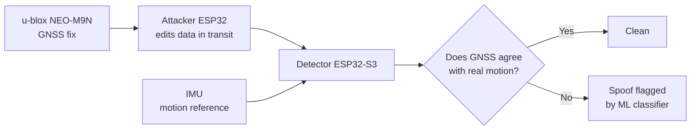

  

  
  

---

## 👋 About me

Final-year B.Tech student in **Electronics and Telecommunication** with a **Data Science minor**, at DYPSEM, Kolhapur. CGPA 8.60.

I work where radio, hardware and machine learning overlap. A GPS fix, a wireless channel and a 60-page contract look nothing alike, but all three can be wrong in ways that are hard to notice. I like building the part that notices.

I've always been pulled toward defense technology, which is why my capstone is about catching fake GPS.

---

## 🛰️ Currently building: GPS spoofing detection

**GPS Spoofing Detection using Low-Cost GNSS and IMU Sensor Fusion**
Embedded Systems and GNSS Navigation Security. Built with a team of four (Vansh Limbad, Rajvardhan Mohite, Hrushiraj Yadav and me), guided by Dr. Aarti A. Chavan.

The idea: a fake GPS signal can show a believable position, but it can't fake how the vehicle is actually moving. So the detector checks if what GNSS claims matches what the motion sensor feels.

| | |
|---|---|
| **Detector** | ESP32-S3 with a NEO-M9N GNSS receiver and an IMU, logging to SD |
| **Attacker** | A second ESP32 sitting in the data path, started wirelessly from a laptop |
| **Test bench** | The whole block rides on an RC car in a box enclosure that fits most cars |
| **Attack scenarios** | Three, each with its own LED signature on the attacker |
| **Training data** | Attacks are injected with randomized values inside bounds taken from published spoofing research (TEXBAT), so the model learns the attack and doesn't memorize a formula |
| **Status** | In active build. Code and write-up will land here after the demo |

---

## 📡 Research: when learned channel estimators meet the real world

Co-authored with Dr. Sutar. **CNN vs MMSE channel estimation in OFDM under distribution mismatch.**

Neural estimators look great when test conditions match training. This paper asks what happens when they don't, and introduces two metrics to measure it:

- **Robustness Ratio**: how much of its performance an estimator keeps when conditions shift
- **Effective SNR Loss**: how many dB of signal quality the mismatch effectively costs

Manuscript in progress, aimed at Elsevier's *Physical Communication*.

---

## 🔧 Things I've shipped

| Project | What it does | Numbers |
|---|---|---|
| [**Project-IQ**](https://github.com/Rishi-D70/Project-IQ) | Reads contracts and policies fully offline and pulls out clauses, obligations, dates and parties. Nothing leaves your machine. | Qwen2.5-7B (4-bit) on llama.cpp with FAISS retrieval. **0.81 precision, 0.74 recall** on 50 CUAD contracts |
| [**Fly-High-Index**](https://github.com/Rishi-D70/Fly-High-Index) | Smart India Hackathon 2026 team project on a real-time airfare price index for India | Team build |
| **Hospital Management System** | Full backend built during my internship at Study Brainz | Django and PostgreSQL, 8 models, **24 pytest tests** |
| **Cattle Breed Classifier** | Image classifier for Indian cattle breeds | MobileNetV2, about 2,600 images, 10 breeds, **82% accuracy** |
| [**Simple_Py_Projects**](https://github.com/Rishi-D70/Simple_Py_Projects) | Small Python builds where I test ideas fast | |

---

## 🧰 Toolkit

**Embedded and signals**

**ML and data**

**Backend**

---

## 🎤 Off the keyboard

- **Documentation Head** at the DYPSEM E-Cell, under E-Cell IIT Bombay
- **Model UN** delegate and chairperson. I've argued for Russia in DISEC and for Finland at UNODC
- Two-time paper presentation winner
- I collect vocabulary words, and I'm slowly dying my way through Elden Ring

---

## 📫 Let's talk

I'm looking for internships from January 2027 and fresher roles across Python, ML and data, and embedded or electronics. If you have a problem with a signal you can't trust, I'd like to hear about it.

  
  

