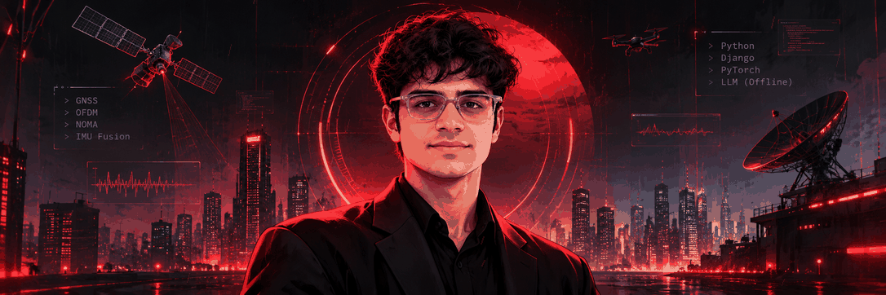
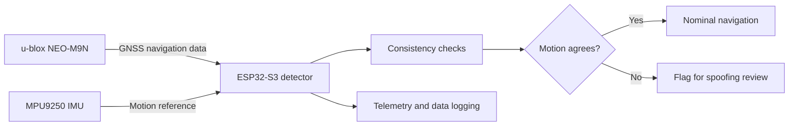

  

<a href="./Rishi_Dulhani_Cyber_City_Banner.png">View static high-resolution PNG version</a>

  

  
  
  
  

  <a href="#profile">PROFILE</a> &nbsp; / &nbsp;
  <a href="#selected-builds">SELECTED BUILDS</a> &nbsp; / &nbsp;
  <a href="#research--publications">RESEARCH</a> &nbsp; / &nbsp;
  <a href="#technical-stack">STACK</a> &nbsp; / &nbsp;
  <a href="#contact">CONTACT</a>

---

## `01 / PROFILE`

**I build systems that turn messy inputs into useful decisions.**

I'm a final-year **B.Tech Electronics & Telecommunication** student with a **Data Science minor** at D. Y. Patil School of Engineering and Management, Kolhapur (**8.60/10 CGPA**, graduating May 2027).

My work sits across three connected areas: **Python backend engineering**, **applied machine learning and local document intelligence**, and **wireless / embedded systems**. I've worked on transaction-safe Django applications, offline contract analysis, computer-vision classification, OFDM channel-estimation research, and an embedded GNSS spoofing-detection prototype.

I care about the engineering underneath the demo: data models, evaluation methodology, edge cases, latency, reproducibility, and whether a system behaves correctly outside the happy path.

  
  
  

### Engineering lanes

<table>
  <tr>
    <td width="33%" valign="top">
      <strong>01 — Backend systems</strong>  
      Django, relational data modelling, PostgreSQL, SQL, transaction safety, query optimisation, and automated tests.  
      Proof point: dashboard queries reduced from ~48 to 6; load time from ~1.4 s to ~450 ms.
    </td>
    <td width="33%" valign="top">
      <strong>02 — Applied ML & local AI</strong>  
      PyTorch, computer vision, document extraction, OCR, retrieval, local LLM inference, and model evaluation.  
      Proof point: offline contract analysis evaluated on 50 CUAD documents.
    </td>
    <td width="33%" valign="top">
      <strong>03 — Wireless & embedded</strong>  
      OFDM, channel estimation, GNSS, IMU sensor fusion, ESP32-based prototyping, and navigation-security research.  
      Proof point: residual CNN experiments across multiple channel profiles.
    </td>
  </tr>
</table>

---

## `02 / SELECTED BUILDS`

A selection of projects where I can show the problem, the implementation choices, and the result — not just the tech stack.

### `A` — ContractIQ / Project-IQ

**Offline contract intelligence | Local LLMs | Retrieval-augmented analysis**

A local-first document intelligence prototype that analyses contracts and policies without sending documents to a cloud service. The repository is named **Project-IQ**; the application is presented as **ContractIQ**.

- **Ingestion:** PDF text extraction with `pdfplumber`, with Tesseract OCR as a fallback for scanned pages.
- **Retrieval and reasoning:** FAISS-based clause retrieval paired with a 4-bit **Qwen2.5-7B** model running locally through `llama.cpp`.
- **Analysis:** clause-aware question answering, extraction of parties / obligations / dates, and risk flags across eight categories with severity and source excerpts.
- **Privacy model:** document processing and inference run locally; contract content is not uploaded to a hosted LLM service.
- **Evaluation:** tested on 50 CUAD contracts across six clause types, reaching **0.81 precision** and **0.74 recall**. A 10-page NDA was analysed in approximately **45 seconds** on the test machine.

Stack: Python · pdfplumber · Tesseract OCR · FAISS · llama.cpp · Qwen2.5-7B · SQLite

---

### `B` — Hospital Management System

**Full-stack developer internship project | Study Brainz | Sep 2025 – Feb 2026**

Built the backend of a hospital management application using Django and PostgreSQL, with an emphasis on reliable booking workflows and efficient database access.

- Designed an **8-model relational schema** using foreign keys and composite indexes.
- Prevented conflicting appointment bookings through database constraints and atomic transactions.
- Optimised dashboard data access from approximately **48 queries to 6**.
- Reduced measured dashboard load time from approximately **1,400 ms to 450 ms**, tested against **5,000 records**.
- Added **24 pytest tests** covering booking conflicts, permissions, and prescription workflows.

Stack: Python · Django · PostgreSQL · SQL · pytest · Git

---

### `C` — OFDM Channel Estimation Under Channel Mismatch

**Wireless communications research | Python · NumPy · PyTorch**

Co-authored research investigating a practical weakness in learned channel estimators: strong in-distribution results can degrade when the propagation channel differs from the training distribution.

- Built a pilot-assisted OFDM simulation with **64 subcarriers** and **QPSK** modulation.
- Implemented **LS**, realistic **LMMSE**, and oracle-LMMSE baselines.
- Trained a **3-layer residual 1D CNN** on 20,000 generated channel samples.
- Compared narrow training (Rayleigh only) with diverse training across **Rayleigh, Rician, EPA, EVA, and ETU** channel profiles.
- At **20 dB on the ETU channel**, the diverse CNN reduced NMSE by **86.59%** and BER by **85.82%** relative to the LMMSE baseline, using **1,000 Monte Carlo runs per SNR point**.
- Developed two evaluation measures — **Robustness Ratio** and **Effective SNR Loss** — to quantify performance degradation under channel mismatch.

Status: co-authored manuscript under review at Elsevier's *Physical Communication*.

---

### `D` — GNSS Spoofing Detection with Low-Cost GNSS + IMU Fusion

**Embedded systems capstone | Navigation security | In progress**

A low-cost defensive prototype designed to identify suspicious GNSS navigation data by checking whether reported satellite-derived movement is consistent with independent inertial measurements.

- **Receiver:** u-blox NEO-M9N; UART1 configured at 115200 baud with UBX-only output at 5 Hz, including NAV-PVT, NAV-SAT, and MON-RF message streams.
- **Compute and sensing:** ESP32-S3 development board with an MPU9250 9-axis inertial sensor.
- **Data path:** UART-based receiver integration, GNSS / IMU data acquisition, and local logging for analysis.
- **Validation concept:** three controlled test scenarios on an RC-car platform, comparing GNSS-derived motion with inertial movement estimates.
- **Research objective:** build a labelled GNSS–IMU dataset and evaluate whether a lightweight detector can identify navigation inconsistencies on-device.

Status: hardware and receiver bring-up are underway; live validation and model performance are not yet claimed.

---

### `E` — Cattle Breed Classification

**Computer vision | PyTorch | Django inference**

- Fine-tuned **MobileNetV2** on approximately **2,600 images across 10 cattle breeds**.
- Used a stratified **70 / 15 / 15** train-validation-test split, weighted loss, and data augmentation.
- Reached **82% accuracy** and **0.80 macro-F1** on the reported evaluation split.
- Used **Grad-CAM** checks to inspect model attention and served predictions through a Django inference endpoint.

Stack: Python · PyTorch · MobileNetV2 · scikit-learn · Grad-CAM · Django

---

### `F` — Fly-High-Index

**Smart India Hackathon 2026 | Team project**

A team-built Smart India Hackathon project exploring a **real-time airfare price index for India**.

Repository: Fly-High-Index

### More code

- [Simple_Py_Projects](https://github.com/Rishi-D70/Simple_Py_Projects) — smaller Python experiments and practice builds.
- [All repositories](https://github.com/Rishi-D70?tab=repositories) — source code and ongoing work.

---

## `03 / EXPERIENCE`

| Role | Organisation | What I worked on |
|---|---|---|
| **Full-Stack Developer Intern** · Sep 2025 – Feb 2026 | **Study Brainz** · Remote | Django backend, PostgreSQL schema design, transaction-safe appointment workflows, dashboard query optimisation, pytest coverage, and a Django-served computer-vision classifier. |
| **Electrical Engineering Intern** · May 2023 – Jun 2023 | **Yadav Electrical Works** · Kolhapur | Assisted with residential / commercial wiring and distribution boards; prepared single-line diagrams and wiring layouts; supported load calculations, cable sizing, BOQs, and electrical testing. |

The electrical internship gave me practical exposure to site execution, switchgear termination, MCB / RCCB selection, earthing, continuity testing, insulation-resistance testing, and site safety procedures.

---

## `04 / RESEARCH & PUBLICATIONS`

| Work | Contribution / recognition |
|---|---|
| **Synergy of OFDMA and NOMA in Modern Wireless Communication** · Apr 2025 | Published research paper, **MAT-Journals**. |
| **OFDM Channel Estimation Under Channel Mismatch** · 2026 | Co-authored manuscript under review at **Elsevier Physical Communication**. |
| **Drone Detection: Differentiating Spy UAVs from Birds** · Mar 2025 | **1st Place**, National Paper Presentation, **IMPULSE 2K25**. |
| **Research Paper Award** · TKIET Tech Fest 2025 | Best Research Paper Award. |

**Other recognition:** 7+ first-place finishes at national-level technical paper presentations, covering wireless communications, defence technology, and applied engineering topics.

---

## `05 / TECHNICAL STACK`

The badges below reflect tools and technologies used across my projects, internship, coursework, and research — not a claim of equal depth in every tool.

**Languages & backend**

  
  
  
  
  
  
  

**Machine learning & document intelligence**

  
  
  
  
  
  
  

**Embedded, electronics & communications**

  
  
  
  
  
  
  

**Tools & engineering practice**

  
  
  
  

---

## `06 / EDUCATION & LEADERSHIP`

**D. Y. Patil School of Engineering and Management — Kolhapur**  
B.Tech, Electronics & Telecommunication · Minor in Data Science · **8.60 / 10 CGPA**  
Jun 2024 – May 2027

**Dr. Bapuji Salokhe Institute of Engineering & Technology — Kolhapur**  
Diploma in Electrical Engineering · **77%**  
Jun 2021 – May 2024

**Leadership and communication**

- **Documentation Head**, DYPSEM E-Cell — contributed to documentation and student entrepreneurship activities.
- **Model United Nations** — participated as a delegate and chairperson, developing research, structured argumentation, and public-speaking skills.

---

## `07 / OUTSIDE THE BUILD LOG`

I collect interesting vocabulary, enjoy a good technical rabbit hole, and spend a questionable amount of time trying to make progress in **Elden Ring**. Model UN and paper presentations keep the communication side of engineering active; building and breaking prototypes keeps the technical side honest.

---

## `08 / CONTACT`

Open to **2027 graduate opportunities and internships** in Python backend development, applied ML / document intelligence, and embedded or wireless systems.

  
  
  

  Direct: <a href="tel:+919096780763">+91 90967 80763</a> &nbsp; | &nbsp; <a href="mailto:rishidulhani7070@gmail.com">rishidulhani7070@gmail.com</a> &nbsp; | &nbsp; <a href="https://www.linkedin.com/in/rishi-dulhani-397987360/">LinkedIn</a>

  <strong>RISHI DULHANI</strong> &nbsp; // &nbsp; Electronics × Software × Intelligence 
  Build it. Measure it. Break it. Make it better.

  

